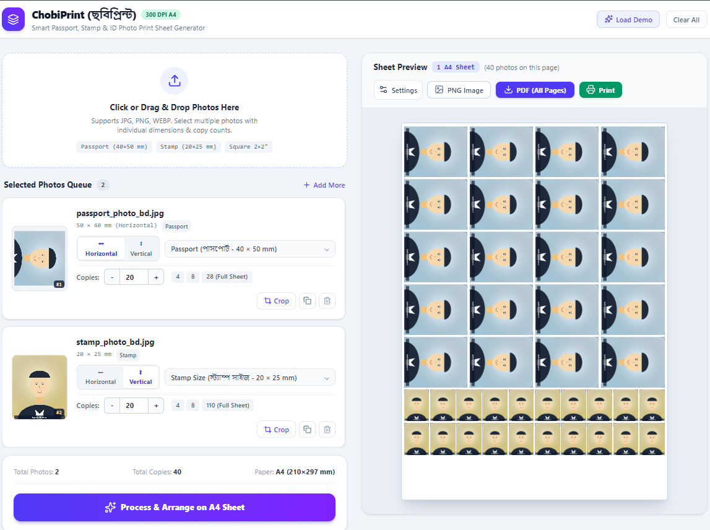

# ChobiPrint - Smart Passport & ID Photo Print Sheet Generator

[](https://react.dev/)
[](https://www.typescriptlang.org/)
[](https://vitejs.dev/)
[](https://tailwindcss.com/)
[]()
[]()
[](https://chobiprint.butterflydevs.top)

> *"Chobi"* means *Picture* or *Photograph* in Bengali. **ChobiPrint** is a modern, privacy-first web utility designed to simplify studio-grade ID and passport photo printing and image conversion for everyone.

🌐 **Live Demo:** [https://chobiprint.butterflydevs.top](https://chobiprint.butterflydevs.top)

Instead of opening complex, heavy desktop software like Adobe Photoshop, **ChobiPrint** allows users to crop, arrange, and print standard passport, stamp, and custom ID photos on A4 photo paper with zero hassle, optimal 2D packing, straight cutting lanes, and 300 DPI lab quality.

<p align="center">
  
</p>

---

## 🌟 Key Features

- **📱 Smartphone / Photoshop-Style Drag Cropping**:
  - Interactive crop box with 8 resizable handles (4 corners + 4 edges).
  - Drag corners and edges to cut into the picture from any side.
  - Aspect ratio locking per dimension standard, plus an optional freeform crop toggle.
  - Optional biometric face oval guide for international passport standards.

- **📄 28 Passport Copies on 1 Single A4 Sheet**:
  - Standard Bangladeshi passport photos ($40 \times 50\text{ mm}$ or $50 \times 40\text{ mm}$) tile in a precise **$4\text{ columns} \times 7\text{ rows} = 28\text{ copies}$** grid on a standard A4 sheet ($210 \times 297\text{ mm}$).

- **✂️ Straight Guillotine Cutting Lanes & Photo Cutting Borders**:
  - Continuous, unbroken horizontal and vertical cut channels across rows and columns.
  - Easily slice entire strips using a standard paper trimmer, rotary cutter, ruler & blade, or scissors.
  - **Photo Cutting Border Line**: Optional crisp 1px cutting border in **Light Gray** or **Fine Black** around each photo—essential for cleanly slicing white-background photos on white paper.

- **☀️ Studio Lighting & Touchup (Brightness & Contrast)**:
  - Interactive Brightness (`-40%` to `+40%`) and Contrast (`-40%` to `+40%`) controls in the crop modal.
  - **✨ 1-Click Auto Enhance**: Instantly balances indoor mobile portraits (`+15%` brightness, `+10%` contrast) with real-time visual preview and 300 DPI lab bake-in.

- **🌐 Dual Language Support (বাংলা & English)**:
  - One-click instant language switcher in the header (`English` ↔ `বাংলা`).
  - Tailored for local Bangladeshi photo studios, cyber cafes, and international users, with persistent settings in `localStorage`.

- **📱 Progressive Web App (PWA) & 100% Offline Support**:
  - **Installable Desktop/Mobile App**: One-click "Install App" button in the header.
  - **Runs Offline**: Service Worker caches all core app resources—print and convert photos without an active internet connection.

- **🔄 Image Converter, Resizer & Quality Optimizer**:
  - **Multi-Format Conversion**: Convert between **JPG / JPEG**, **PNG**, and **WEBP** instantly in the browser.
  - **Custom Dimensions & Scaling**: Resize by exact pixels (`px`), millimeters (`mm` @ 300 DPI), or percentage scaling (`25%`, `50%`, `75%`, `100%`, `150%`, `200%`).
  - **Aspect Ratio Locking**: Keep original photo proportions or resize freely with the proportional lock toggle.
  - **Studio Presets**: One-click quick presets for Passport 40×50 mm, Stamp 20×25 mm, 1080p FHD, and 500px square avatars.
  - **Quality Compression Slider**: Real-time slider (1% to 100%) showing immediate before/after file size and space saved (e.g. `🔻 77% Smaller`).
  - **Batch ZIP Export**: Download individual converted images or download all in a single `.zip` file using `jszip`.
  - **Direct Bridge to Print Sheet**: Easily transfer converted & resized photos directly into the passport print layout generator.

- **🌱 Smart Paper-Saving Layout**:
  - Top-aligned vertical packing leaves all unused photo paper consolidated in one clean block at the bottom.
  - Dashed cut-line indicator shows exactly where to cut to preserve clean, unprinted photo paper for future printer runs.

- **🗂️ Multi-Photo Queue with Independent Settings**:
  - Add multiple distinct photos in one session.
  - Each photo card supports independent dimension presets, custom sizes, horizontal/vertical toggles, and copy counts.

- **🔒 100% Private & Client-Side**:
  - All processing is performed locally in your browser using HTML5 Canvas.
  - **Zero cloud uploads**—your personal photographs never leave your computer.

- **🖨️ Professional High-Resolution Export**:
  - **300 DPI Vector/Raster PDF** (scaled to true millimeter units using `jsPDF`).
  - **300 DPI PNG Images** ($2480 \times 3508\text{ px}$).
  - **Direct Browser 1:1 Scale Print** via `@media print`.

---

## 📐 Supported Standard Dimensions

| Preset Name | Dimensions (Metric) | Dimensions (Imperial) | Resolution @ 300 DPI | Common Usages |
| :--- | :--- | :--- | :--- | :--- |
| **Passport (Studio Standard)** | **40 × 50 mm** | 1.57 × 1.97 in | 472 × 591 px | Bangladesh job applications, university/college admissions, BCS, CV |
| **Passport (Official MRP / e-Passport)** | **45 × 55 mm** | 1.77 × 2.17 in | 531 × 650 px | Bangladesh official physical passport & visa application forms |
| **Passport / Visa (International)** | **35 × 45 mm** | 1.38 × 1.77 in | 413 × 531 px | Bangladesh visa, international IDs, Schengen, UK, Canada |
| **Stamp Size (স্ট্যাম্প সাইজ)** | **20 × 25 mm** | 0.79 × 0.98 in | 236 × 295 px | Admit cards, student IDs, registration papers, revenue stamps |
| **Square (US Visa / Embassy)** | **50.8 × 50.8 mm** (2×2") | 2.00 × 2.00 in | 600 × 600 px | US Visa (DS-160), Diversity Visa (DV), square portraits |
| **Square (1.5 × 1.5")** | **38.1 × 38.1 mm** | 1.50 × 1.50 in | 450 × 450 px | Institutional ID cards |
| **Square (Micro Stamp 1 × 1")** | **25.4 × 25.4 mm** | 1.00 × 1.00 in | 300 × 300 px | Compact micro square stamps |
| **Custom Dimensions** | *User Defined* | `mm`, `cm`, `inch`, `px` | Custom calculated | Any customized frame or ID card dimension |

---

## 🚀 Getting Started

### Prerequisites

- Node.js (version 18 or newer recommended)
- npm or yarn

### Installation

```bash
# Clone the repository
git clone https://github.com/nazmulhasan77/ChobiPrint-Smart-Passport-ID-Photo-Print-Sheet-Generator.git

# Navigate to project folder
cd ChobiPrint-Smart-Passport-ID-Photo-Print-Sheet-Generator

# Install dependencies
npm install

# Start local development server
npm run dev
```

Open your browser at `http://localhost:5173/` to use the application.

### Production Build

```bash
npm run build
```

The optimized production output will be generated inside the `dist/` directory.

---

## 🛠️ Tech Stack

- **Framework**: [React 19](https://react.dev/) + [TypeScript](https://www.typescriptlang.org/)
- **Bundler**: [Vite](https://vitejs.dev/)
- **Styling**: [Tailwind CSS v4](https://tailwindcss.com/)
- **Icons**: [Lucide React](https://lucide.dev/)
- **PDF Generation**: [jsPDF](https://github.com/parallax/jsPDF)
- **Batch ZIP Packaging**: [JSZip](https://stuk.github.io/jszip/)
- **Image Processing**: HTML5 Canvas API (High-DPI 300 DPI rendering)

---

## 📄 License

This project is open source and available under the [MIT License](LICENSE).
